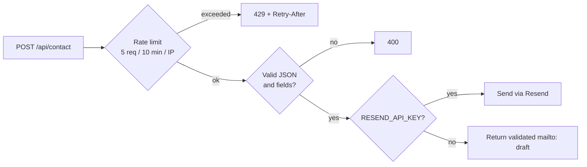

<div align="center">


### Multi-page portfolio documented from the problem to the result

[](https://nextjs.org)
[](https://react.dev)
[](https://www.typescriptlang.org)
[](https://tailwindcss.com)


<br/>

<a href="https://skillicons.dev">
  
</a>

<br/><br/>

[Demo](#) · [Routes](#routes) · [Skins](#skins) · [Contact API](#contact-api)

</div>

---

## Table of contents

- [Overview](#overview)
- [Stack](#stack)
- [Routes](#routes)
- [Quick start](#quick-start)
- [Skins](#skins)
- [Environment](#environment)
- [Contact API](#contact-api)
- [Architecture notes](#architecture-notes)
- [Quality checklist](#quality-checklist)
- [License](#license)

---

## Overview

Portfolio focused on **software development**, **databases**, **Linux hardening**, and **local tools**. Each project is documented end to end: the problem, the decisions, the code, and the results.

> [!NOTE]
> No UI framework, no animation library, and no client-side data-fetching dependencies. Everything is built on a custom design system driven by CSS variables.

---

## Stack

| | Technology | Notes |
| :---: | --- | --- |
|  | **Next.js 16** | App Router, React Server Components where possible |
|  | **React 19** | UI layer |
|  | **TypeScript** | End-to-end typing |
|  | **Tailwind CSS** | Custom design system on CSS variables |
|  | **Route Handlers** | Health checks and contact validation |

---

## Routes

| Route | Purpose |
| --- | --- |
| `/` | Introduction, project highlights, results, and working principles |
| `/proyectos` | Searchable and filterable project index |
| `/proyectos/[id]` | Project detail: problem, architecture, decisions, results, and code |
| `/sobre-mi` | Profile, background, tools, and recent work |
| `/otaku` | Anime and game inspirations, one site skin per entry |
| `/contacto` | Validated contact form with a `mailto` fallback |

---

## Quick start

```bash
npm install
cp .env.example .env.local   # Windows: copy .env.example .env.local
npm run dev
```

Open **http://localhost:3000**

<details>
<summary><b>Other scripts</b></summary>

```bash
npm run build       # production build
npm run start       # serve the production build
npm run typecheck   # TypeScript check
```

</details>

---

## Skins

`data-skin` on `<html>` switches the palette and effects. Every skin uses a dark palette; the accent and atmosphere change with each one.

| Skin | Inspiration |
| --- | --- |
| Persona | Persona series |
| Toga | My Hero Academia |
| Yofukashi no Uta | Call of the Night |
| Nichijou | Nichijou |
| Kill la Kill | Kill la Kill |
| Dregxmoon | **Secret skin** |

- Skins live in `src/lib/skins.ts`; their CSS variables in `src/styles/globals.css`.
- The picker is available in the navbar and mobile menu.
- The **Konami code** unlocks the hidden skin.
- `/otaku` documents the inspiration behind each one.

---

## Environment

See [`.env.example`](.env.example).

| Variable | Required | Description |
| --- | :---: | --- |
| `NEXT_PUBLIC_SITE_URL` | No | Canonical URL for `metadataBase`, Open Graph, sitemap, and robots. Falls back to `http://localhost:3000` |
| `RESEND_API_KEY` | No | Enables contact-form delivery through [Resend](https://resend.com) |
| `CONTACT_TO_EMAIL` | No | Recipient address |
| `CONTACT_FROM_EMAIL` | No | Sender address |

---

## Contact API

`POST /api/contact` validates **name**, **email**, and **message**.



> [!TIP]
> Without `RESEND_API_KEY`, the endpoint returns a validated `mailto:` draft, so the form works with zero configuration.

---

## Architecture notes

<details open>
<summary><b>Core</b></summary>

- **Shared shell** — `src/components/SiteShell.tsx` owns language, skin, and shared navigation state so pages keep the selected preferences.
- **Design tokens** — RGB channel variables (`--ink-rgb`, `--acc-rgb`, …) allow Tailwind opacity modifiers such as `border-ink/20`, while each skin sets a fixed palette and border/shadow tokens (`--line`, `--wash`).
- **Metadata** — canonical URLs, Open Graph, and Twitter cards are generated from `src/lib/site.ts`.

</details>

<details>
<summary><b>Security</b></summary>

- **Headers** — CSP, HSTS, nosniff, frame denial, referrer policy, and Permissions Policy are configured in `next.config.js`.
- **Rate limiting** — `src/lib/rate-limit.ts` applies an in-memory fixed window per client IP.

> [!WARNING]
> Replace the in-memory store with Redis for multi-instance or serverless deployments.

</details>

<details>
<summary><b>Assets and edge cases</b></summary>

- **Images** — originals live in `assets/images`; only optimized derivatives are shipped from `public`.
- **404 metadata** — Next.js can ignore metadata exported from `not-found.tsx` for unmatched routes; `NotFoundMeta` sets the title and `noindex, nofollow` on the client while the route still responds with HTTP `404`.

</details>

---

## Quality checklist

- [x] Keyboard navigation and a skip link on every page
- [x] `prefers-reduced-motion` handling for the ticker and card effects
- [x] Responsive down to 390 px without horizontal scroll
- [x] Validated API input with `400` / `429` responses and `Retry-After`
- [x] No third-party analytics or trackers

---

## License

Personal portfolio. Case-study text and identity assets are **not reusable without permission**; code patterns may be referenced.

<div align="center">

<br/>


</div>
